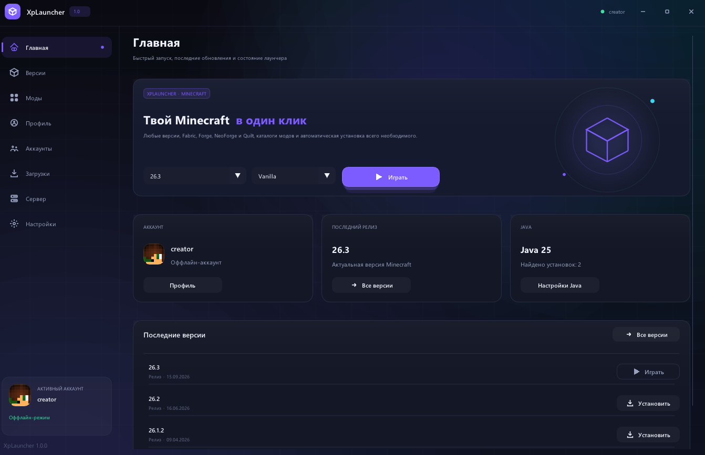
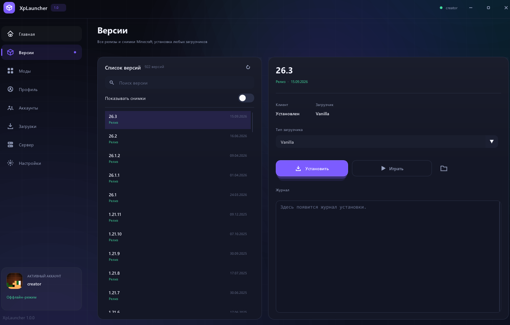
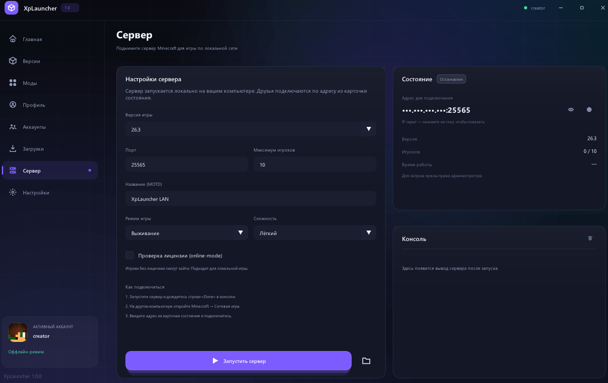
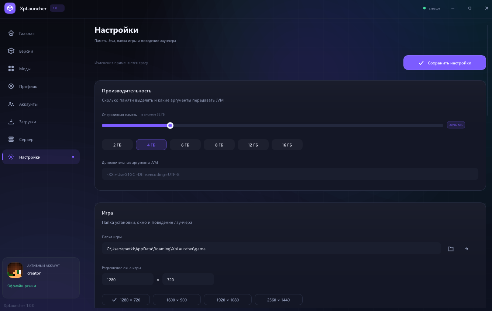

<div align="center">
  <a href="https://github.com/slipptech-tech/XpLauncher">
    
  </a>
</div>

<h3 align="center">A refined way to experience Minecraft.</h3>

<p align="center">
  Every version, every loader, every mod — in one fast, native launcher for Windows.<br>
  No Electron, no installers, no manual Java setup.
</p>

<p align="center">
  <a href="https://github.com/slipptech-tech/XpLauncher/releases/latest"></a>
  <a href="https://github.com/slipptech-tech/XpLauncher/releases"></a>
  <a href="https://github.com/slipptech-tech/XpLauncher/blob/main/LICENSE"></a>
  
</p>

<p align="center">
  <a href="https://xplauncher.pages.dev"></a>
  <a href="https://github.com/slipptech-tech/XpLauncher/releases/latest/download/XpLauncher.exe"></a>
</p>

<p align="center">
  <a href="https://github.com/slipptech-tech/XpLauncher/releases"></a>
  <a href="https://github.com/slipptech-tech/XpLauncher/issues"></a>
  <a href="https://github.com/slipptech-tech/XpLauncher/discussions"></a>
</p>

---

## Overview

**XpLauncher** is a Minecraft launcher written from scratch in C++20. It talks directly to Mojang, Fabric, Quilt, Forge, NeoForge, Modrinth, CurseForge and Adoptium, so everything from downloading a version to installing Java happens in one place — quickly and without third-party installers.

The interface is rendered with Dear ImGui on top of DirectX 11 inside a frameless, DPI-aware Win32 window. No web view, no bundled browser, no background services: a single executable that starts in a fraction of a second.

|  |  |
|:--|:--|
| **Platform** | Windows 10 / 11, 64-bit |
| **Built with** | C++20 · Win32 · DirectX 11 · Dear ImGui |
| **Footprint** | Single ~1.5 MB executable, no runtime dependencies |
| **Price** | Free, open source, no ads |
| **License** | [MIT](LICENSE) |
| **Website** | [xplauncher.pages.dev](https://xplauncher.pages.dev) |

## Screenshots

| Home | Versions & loaders |
|:--:|:--:|
| [](docs/screens/home.png) | [](docs/screens/versions.png) |
| **Mods** | **LAN server** |
| [](docs/screens/mods.png) | [](docs/screens/server.png) |
| **Profile** | **Settings** |
| [](docs/screens/profile.png) | [](docs/screens/settings.png) |

## Features

| Feature | What it does |
|:--|:--|
| **Every Minecraft version** | Releases and snapshots are pulled from the official Mojang manifest, so the list is always current. |
| **All four loaders** | Fabric, Quilt, Forge and NeoForge install in one click, with all required libraries and the correct launch profile. |
| **Mods inside the launcher** | Search, filter and install from Modrinth and CurseForge without leaving the app — with icons, descriptions and download counts. |
| **Java that just works** | Finds existing installations through `JAVA_HOME`, `PATH`, the registry and common folders; if nothing fits, it downloads the right Temurin JRE from Adoptium. |
| **Microsoft accounts** | Sign in with the device-code flow (Xbox Live + XSTS), keep the session refreshed, and launch with a licensed profile. Offline profiles work too. |
| **LAN server in one click** | Choose a world, adjust the settings and start a local server. XpLauncher builds the command line and handles elevation for you. |
| **Download manager** | Every version, library, asset and mod download is queued, cancellable and visible with live progress and logs. |
| **Profile and statistics** | Playtime, launch history and per-version activity, collected locally. |
| **Real desktop app** | Frameless DPI-aware window with a custom title bar, smooth page transitions, animated popups and an accent color you can change. |
| **Your game, your way** | Memory allocation, extra JVM arguments, game folder, resolution, fullscreen, snapshots and more. |

## Download

Grab the latest build directly — no installer, no extra steps:

<p>
  <a href="https://github.com/slipptech-tech/XpLauncher/releases/latest/download/XpLauncher.exe"></a>
</p>

**Requirements**

- Windows 10 or 11 (64-bit)
- 4 GB of RAM and roughly 1 GB of free disk space
- An internet connection for the first launch
- Java is not required — the launcher installs it when needed

**First run**

1. Run `XpLauncher.exe`.
2. Windows SmartScreen may warn because the build is not code-signed — choose **More info → Run anyway**.
3. Select a version and a loader, press **Play**, and let the launcher download everything.

## Build from source

**Prerequisites:** Visual Studio 2022 with the *Desktop development with C++* workload and CMake 3.21 or newer.

```bash
git clone https://github.com/slipptech-tech/XpLauncher.git
cd XpLauncher
cmake -S . -B build -G "Visual Studio 17 2022" -A x64
cmake --build build --config Release
```

The build produces `build/Release/XpLauncher.exe`. Dear ImGui, nlohmann/json, miniz and stb_image are vendored in `third_party/`; everything else comes from the Windows SDK.

## Tech stack

| Layer | Technology |
|:--|:--|
| Language | C++20 |
| UI | [Dear ImGui](https://github.com/ocornut/imgui) 1.93 with a custom widget and theme layer |
| Rendering | DirectX 11 |
| Windowing | Win32, DWM, per-monitor DPI awareness |
| Networking | WinHTTP with asynchronous task queue |
| JSON | [nlohmann/json](https://github.com/nlohmann/json) |
| Archives | [miniz](https://github.com/richgel999/miniz) |
| Images | stb_image |
| Build | CMake + MSVC |

## Project structure

```text
src/
  main.cpp          Win32 entry point: window, D3D11 device, message loop
  app.cpp/.hpp      Application shell: tabs, navigation, modals, toasts, animations
  ui.cpp/.hpp       Theme, DPI scaling and reusable widgets
  core.cpp/.hpp     Configuration, HTTP, filesystem, tasks, Java discovery and install
  minecraft.cpp     Version manifest, file downloads, loaders, game launch
  mods.cpp          Modrinth and CurseForge search and installation
  msa.cpp           Microsoft OAuth, Xbox Live, XSTS, Minecraft profile
  app_msa.cpp       Account sign-in flow
  page_*.cpp        One file per tab: home, versions, mods, profile, accounts,
                    downloads, server, settings
resources/          Icon, version info and resource definitions
third_party/        Dear ImGui, nlohmann/json, miniz, stb_image
docs/               Banner and screenshots
```

## Integrations

| Service | Used for |
|:--|:--|
| Mojang Piston Meta | Version manifest, libraries and assets |
| Fabric Meta / Quilt Meta | Loader versions and launch profiles |
| Forge / NeoForge Maven | Loader builds and installers |
| Modrinth / CurseForge | Mod search, metadata and downloads |
| Adoptium | Temurin JRE downloads |
| Microsoft / Xbox Live | Account authentication |
| mc-heads.net | Player avatars |

## Where your data lives

| Path | Contents |
|:--|:--|
| `%APPDATA%\XpLauncher\config.json` | Launcher settings |
| `%APPDATA%\XpLauncher\game\` | Versions, libraries, assets and mods |
| `%APPDATA%\XpLauncher\java\` | Java runtimes installed by the launcher |

The game folder can be changed at any time in **Settings → Game**.

## FAQ

<details>
<summary>Do I need to install Java manually?</summary>
<p>No. XpLauncher scans the system for a suitable runtime and downloads Temurin from Adoptium if none is found. You can also point it to a specific Java folder in the settings.</p>
</details>

<details>
<summary>Can I play with a Microsoft account?</summary>
<p>Yes. Licensed Microsoft accounts are supported through the device-code sign-in flow. Offline profiles are available for local play; multiplayer servers require a licensed account.</p>
</details>

<details>
<summary>Why does Windows SmartScreen warn me?</summary>
<p>The executable is not signed with a paid certificate, so Windows shows the standard warning. Choose <b>More info → Run anyway</b>, or verify the file against the GitHub release.</p>
</details>

<details>
<summary>Which loaders and versions are supported?</summary>
<p>Every release and snapshot from the official manifest, with Fabric, Quilt, Forge and NeoForge builds where they exist for that version.</p>
</details>

<details>
<summary>Is any data sent anywhere?</summary>
<p>The launcher talks only to the services listed above to download versions, mods, Java and to authenticate your account. Statistics and settings stay on your machine.</p>
</details>

## Contributing

Issues and pull requests are welcome. If you find a bug, please include the launcher version, your Windows version and the log from the Downloads tab. For larger changes, open a discussion first so we can agree on the approach.

## License

XpLauncher is released under the [MIT License](LICENSE). © SlippTech.

## Support the project

XpLauncher is free, with no ads, subscriptions or hidden fees. If you enjoy it, you can support development:

<p>
  <a href="https://buymeacoffee.com/slipptech"></a>
</p>

---

<p align="center">
  <sub>Not affiliated with Mojang Studios or Microsoft. Minecraft is a trademark of Mojang Synergies AB.</sub>
</p>
