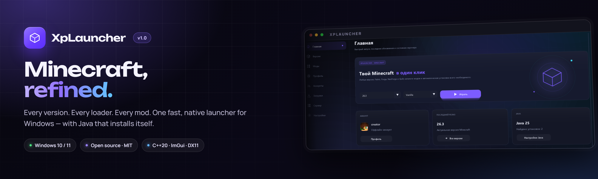
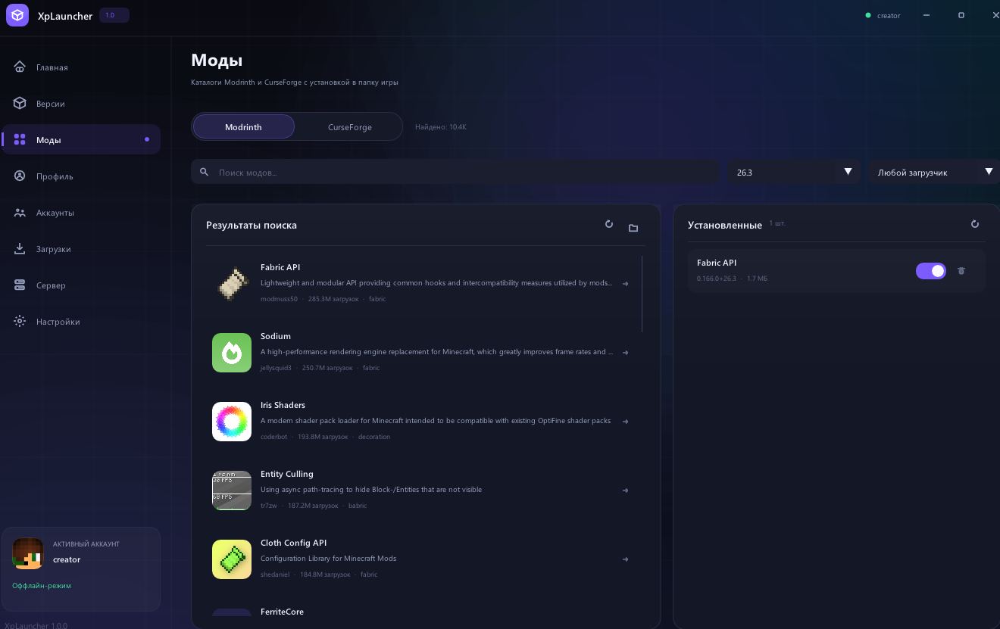
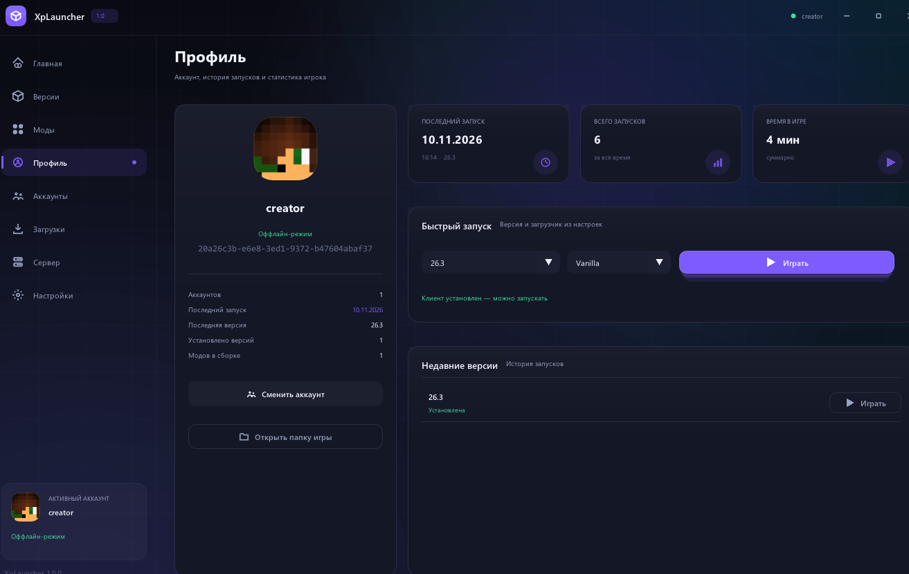

  

<h3 align="center">A refined way to experience Minecraft.</h3>

  Every version, every loader, every mod — in one fast, native launcher for Windows. 
  No Electron, no installers, no manual Java setup.

  <b><a href="https://xplauncher.pages.dev">Website</a></b>
  &nbsp;&nbsp;·&nbsp;&nbsp;
  <b><a href="https://github.com/slipptech-tech/XpLauncher/releases/latest/download/XpLauncher.exe">Download</a></b>
  &nbsp;&nbsp;·&nbsp;&nbsp;
  <a href="https://github.com/slipptech-tech/XpLauncher/releases">Releases</a>
  &nbsp;&nbsp;·&nbsp;&nbsp;
  <a href="https://github.com/slipptech-tech/XpLauncher/issues">Issues</a>
  &nbsp;&nbsp;·&nbsp;&nbsp;
  <a href="https://github.com/slipptech-tech/XpLauncher/discussions">Discussions</a>

  Official website: <a href="https://xplauncher.pages.dev">xplauncher.pages.dev</a>

## Overview

XpLauncher is a Minecraft launcher written from scratch in C++20. It talks directly to Mojang, Fabric, Quilt, Forge, NeoForge, Modrinth, CurseForge and Adoptium, so everything from downloading a version to installing Java happens in one place — quickly and without third-party installers.

The interface is rendered with Dear ImGui on top of DirectX 11 inside a frameless, DPI-aware Win32 window. No web view, no bundled browser, no background services: a single executable that starts in a fraction of a second.

## Screenshots

| Home | Versions & loaders |
|:--:|:--:|
|  |  |
| **Mods** | **LAN server** |
|  |  |
| **Profile** | **Settings** |
|  |  |

## Features

| Feature | What it does |
|:--|:--|
| **Every Minecraft version** | Releases and snapshots are pulled from the official Mojang manifest, so the list is always current. |
| **All four loaders** | Fabric, Quilt, Forge and NeoForge install in one click, with all required libraries and the correct launch profile. |
| **Mods inside the launcher** | Search, filter and install from Modrinth and CurseForge without leaving the app — with icons, descriptions and download counts. |
| **Java that just works** | Finds existing installations through `JAVA_HOME`, `PATH`, the registry and common folders; if nothing fits, it downloads the right Temurin JRE from Adoptium. |
| **Microsoft accounts** | Sign in with the device-code flow (Xbox Live + XSTS), keep the session refreshed, and launch with a licensed profile. Offline profiles work too. |
| **LAN server in one click** | Choose a world, adjust the settings and start a local server. XpLauncher builds the command line and handles elevation for you. |
| **Download manager** | Every version, library, asset and mod download is queued, cancellable and visible with live progress and logs. |
| **Profile and statistics** | Playtime, launch history and per-version activity, collected locally. |
| **Real desktop app** | Frameless DPI-aware window with a custom title bar, smooth page transitions, animated popups and an accent color you can change. |
| **Your game, your way** | Memory allocation, extra JVM arguments, game folder, resolution, fullscreen, snapshots and more. |

## Download

Grab the latest build directly — no installer, no extra steps:

**[Download XpLauncher.exe](https://github.com/slipptech-tech/XpLauncher/releases/latest/download/XpLauncher.exe)** — the latest build, no installer required.

